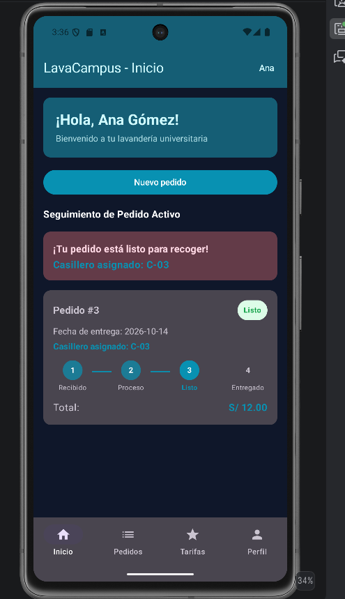
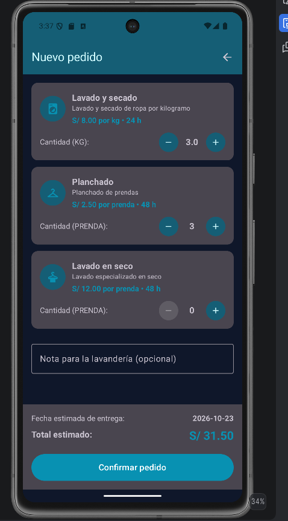
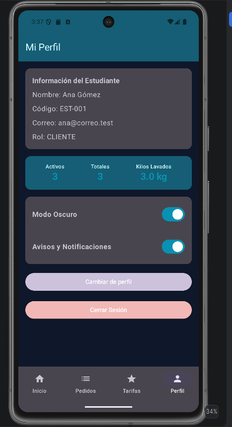
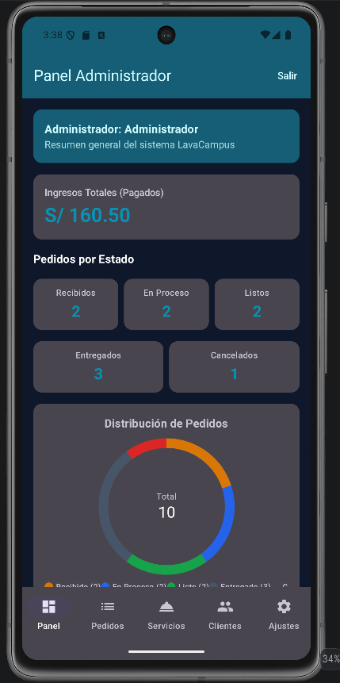
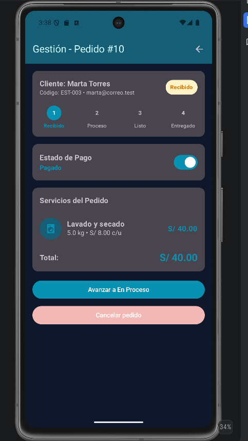
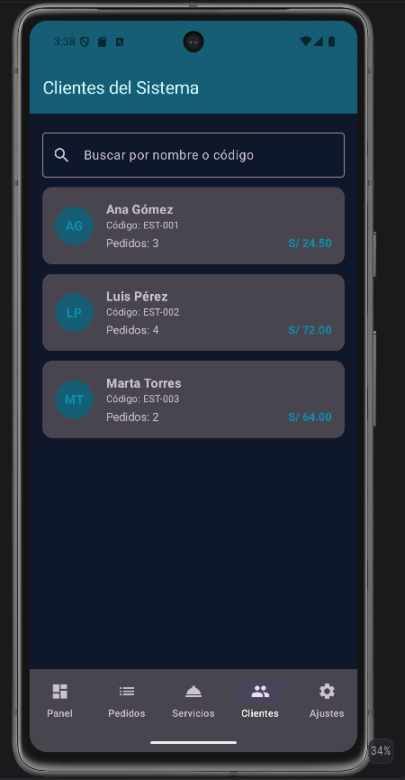

# LavaCampus

Aplicación móvil para la gestión de una lavandería universitaria, desarrollada como parte del curso de **Programación en Móviles**.

**Autor:** Noe Oswaldo Escobal Huayana  
**Curso:** Programación en Móviles  
**Institución:** TECSUP  
**Proyecto:** Laboratorio MVVM + Room - LavaCampus SIN IA

---

## Descripción

LavaCampus es una aplicación Android desarrollada con Kotlin y Jetpack Compose que permite gestionar el servicio de lavandería de un campus universitario.

La aplicación cuenta con dos perfiles: **Estudiante** y **Administrador**.

El estudiante puede iniciar sesión, consultar sus pedidos, registrar nuevos pedidos de lavandería, revisar tarifas, realizar seguimiento del estado de sus pedidos y administrar algunas preferencias de su perfil.

El administrador dispone de un panel general, gestión de pedidos, servicios y clientes, además de opciones para controlar la recepción de nuevos pedidos y otras preferencias de la aplicación.

La información se almacena localmente mediante Room y las preferencias de la aplicación se mantienen utilizando DataStore.

---

## Requisitos funcionales

### Perfil Estudiante

- Iniciar sesión como estudiante.
- Visualizar el pedido activo y su estado.
- Consultar los últimos pedidos realizados.
- Registrar un nuevo pedido.
- Seleccionar servicios y cantidades.
- Calcular automáticamente el total del pedido.
- Calcular la fecha estimada de entrega.
- Consultar el detalle de un pedido.
- Cancelar pedidos que todavía se encuentren en estado `RECIBIDO`.
- Consultar el historial de pedidos.
- Consultar las tarifas de los servicios activos.
- Visualizar información y estadísticas del perfil.
- Activar o desactivar el modo oscuro.
- Configurar avisos y notificaciones.
- Cambiar al perfil de administrador.
- Cerrar sesión.

### Perfil Administrador

- Visualizar un panel con indicadores generales.
- Consultar pedidos de todos los estudiantes.
- Buscar y filtrar pedidos.
- Avanzar pedidos entre sus diferentes estados.
- Asignar casilleros disponibles.
- Registrar el pago de un pedido.
- Gestionar los servicios de lavandería.
- Crear y editar servicios.
- Desactivar servicios utilizados anteriormente.
- Consultar la lista de clientes.
- Buscar clientes por nombre o código.
- Consultar cantidad de pedidos y gasto por cliente.
- Activar o desactivar la recepción de nuevos pedidos.
- Configurar modo oscuro y notificaciones.
- Cambiar al perfil de estudiante.
- Cerrar sesión.

---

## Tecnologías utilizadas

- Kotlin
- Jetpack Compose
- Material 3
- MVVM
- Room
- DataStore Preferences
- Navigation Compose
- Kotlin Coroutines
- Flow y StateFlow
- KSP
- Gradle

### Configuración utilizada

- Kotlin: `2.2.10`
- KSP: `2.2.10-2.0.2`
- Room: `2.7.2`
- JVM: `21`
- minSdk: `26`

> Se utilizó Room 2.7.2 debido a compatibilidad con la versión de Kotlin/KSP empleada por el proyecto. Con Room 2.6.1 se producía un error durante `kspDebugKotlin`, mientras que con Room 2.7.2 el proyecto compila correctamente.

---

## Arquitectura

El proyecto utiliza el patrón **MVVM (Model - View - ViewModel)**.

```text
┌──────────────────────────────┐
│             VIEW             │
│     Pantallas / Compose      │
└──────────────┬───────────────┘
               │ eventos
               ▼
┌──────────────────────────────┐
│          VIEWMODEL           │
│ Estado + reglas de negocio   │
│     Flow / StateFlow         │
└──────────────┬───────────────┘
               │
               ▼
┌──────────────────────────────┐
│          REPOSITORY          │
│       LavaRepository         │
│     LavaRepositoryRoom      │
└──────────┬───────────┬───────┘
           │           │
           ▼           ▼
┌──────────────────┐ ┌──────────────────┐
│ DAO / ROOM       │ │    DATASTORE     │
│ lavacampus.db    │ │   Preferencias   │
└──────────────────┘ └──────────────────┘
```

Las pantallas de Jetpack Compose representan la vista. Los ViewModels administran el estado y contienen las reglas de negocio. El repositorio funciona como intermediario entre los ViewModels y las fuentes de datos.

Room se utiliza para la información principal de la lavandería y DataStore para conservar preferencias de la aplicación.

---

## Estructura del proyecto

```text
com.tecsup.lavacampus
│
├── MainActivity.kt
│
├── data
│   ├── local
│   │   ├── DatosIniciales.kt
│   │   ├── LavaDatabase.kt
│   │   │
│   │   ├── dao
│   │   │   ├── DetalleDao.kt
│   │   │   ├── PedidoDao.kt
│   │   │   ├── ServicioDao.kt
│   │   │   └── UsuarioDao.kt
│   │   │
│   │   ├── entity
│   │   │   ├── DetallePedido.kt
│   │   │   ├── Pedido.kt
│   │   │   ├── Servicio.kt
│   │   │   └── Usuario.kt
│   │   │
│   │   └── relation
│   │       ├── DetalleConServicio.kt
│   │       └── PedidoConDetalle.kt
│   │
│   ├── prefs
│   │   └── PreferenciasStore.kt
│   │
│   └── repository
│       ├── LavaRepository.kt
│       └── LavaRepositoryRoom.kt
│
├── model
│   ├── Casilleros.kt
│   ├── ClienteResumen.kt
│   ├── EstadoPedido.kt
│   ├── IngresoServicio.kt
│   ├── LineaPedido.kt
│   ├── Rol.kt
│   └── Unidad.kt
│
├── ui
│   ├── admin
│   │   ├── AjustesScreen.kt
│   │   ├── BandejaScreen.kt
│   │   ├── ClientesScreen.kt
│   │   ├── FormularioServicioScreen.kt
│   │   ├── GestionPedidoScreen.kt
│   │   ├── PanelScreen.kt
│   │   └── ServiciosScreen.kt
│   │
│   ├── components
│   │   ├── AdminBottomBar.kt
│   │   ├── AppTopBar.kt
│   │   ├── EstadoPedidoChip.kt
│   │   ├── IconoServicio.kt
│   │   ├── LavaButton.kt
│   │   ├── PedidoCard.kt
│   │   ├── SelectorCantidad.kt
│   │   ├── SplashScreen.kt
│   │   ├── StepperEstado.kt
│   │   ├── StudentBottomBar.kt
│   │   │
│   │   └── graficos
│   │       ├── GraficoBarras.kt
│   │       └── GraficoDona.kt
│   │
│   ├── estudiante
│   │   ├── DetallePedidoScreen.kt
│   │   ├── InicioScreen.kt
│   │   ├── LoginScreen.kt
│   │   ├── MisPedidosScreen.kt
│   │   ├── NuevoPedidoScreen.kt
│   │   ├── PerfilScreen.kt
│   │   ├── ServiciosScreen.kt
│   │   └── TarifasScreen.kt
│   │
│   └── theme
│       ├── Color.kt
│       ├── Theme.kt
│       └── Type.kt
│
└── viewmodel
    ├── AdminServiciosViewModel.kt
    ├── BandejaViewModel.kt
    ├── ClientesViewModel.kt
    ├── DetallePedidoViewModel.kt
    ├── GestionPedidoViewModel.kt
    ├── InicioViewModel.kt
    ├── LavaViewModelFactory.kt
    ├── MisPedidosViewModel.kt
    ├── NuevoPedidoViewModel.kt
    ├── PanelViewModel.kt
    ├── PerfilViewModel.kt
    ├── SesionViewModel.kt
    └── TarifasViewModel.kt
```

---

## Base de datos

La base de datos local se denomina:

```text
lavacampus.db
```

Está compuesta principalmente por cuatro tablas:

### usuarios

Almacena los estudiantes y administradores que pueden acceder a la aplicación.

### servicios

Contiene los servicios ofrecidos por la lavandería, incluyendo nombre, descripción, unidad, precio, tiempo de entrega y estado activo.

### pedidos

Registra los pedidos realizados por los estudiantes, su estado, fecha de entrega, total, pago y casillero asignado.

### detalles_pedido

Contiene las líneas individuales de cada pedido y relaciona un pedido con los servicios seleccionados.

---

## Reglas de negocio

Las principales reglas implementadas son:

1. Un estudiante solo puede visualizar sus propios pedidos.
2. Un administrador puede visualizar todos los pedidos.
3. Solo se pueden seleccionar servicios activos.
4. Debe existir al menos un servicio con cantidad mayor que cero para crear un pedido.
5. Los servicios por kilogramo admiten cantidades entre 1.0 y 10.0 kg en intervalos de 0.5 kg.
6. Los servicios por prenda o unidad utilizan cantidades enteras.
7. Un estudiante puede tener como máximo tres pedidos activos.
8. El total se obtiene sumando los subtotales de los servicios seleccionados.
9. El precio utilizado queda almacenado en el detalle del pedido.
10. La fecha de entrega se calcula utilizando el mayor tiempo de entrega de los servicios seleccionados.
11. Si la fecha calculada corresponde a domingo, la entrega pasa al lunes.
12. Un estudiante solamente puede cancelar pedidos en estado `RECIBIDO`.
13. Los estados avanzan en el siguiente orden:

```text
RECIBIDO → EN_PROCESO → LISTO → ENTREGADO
```

14. Un pedido no puede retroceder de estado.
15. Para pasar un pedido a `LISTO` se debe asignar un casillero disponible.
16. Los casilleros disponibles van desde `C-01` hasta `C-30`.
17. Un pedido solo puede pasar a `ENTREGADO` si previamente fue marcado como pagado.
18. Un servicio utilizado en pedidos anteriores no se elimina; solamente puede ser desactivado.
19. Si el administrador desactiva la recepción de pedidos, el estudiante no puede registrar uno nuevo.
20. El perfil seleccionado y el modo oscuro se conservan al cerrar y volver a abrir la aplicación.

---

## Flujo de estados del pedido

```text
                    ┌────────────┐
                    │  RECIBIDO  │
                    └─────┬──────┘
                          │
                          ▼
                  ┌───────────────┐
                  │  EN_PROCESO   │
                  └───────┬───────┘
                          │
                    requiere casillero
                          │
                          ▼
                    ┌──────────┐
                    │  LISTO   │
                    └────┬─────┘
                         │
                   requiere pago
                         │
                         ▼
                  ┌────────────┐
                  │ ENTREGADO  │
                  └────────────┘
```

Los pedidos permitidos por las reglas correspondientes también pueden terminar en estado `CANCELADO`.

---

# Capturas de pantalla

## Perfil Estudiante

### Inicio

En la pantalla principal el estudiante puede visualizar su pedido activo, realizar seguimiento de su estado y acceder a las principales opciones de la aplicación.



### Nuevo pedido

La aplicación permite seleccionar los servicios y sus cantidades, calculando automáticamente el total y la fecha estimada de entrega.



### Perfil

El perfil muestra los datos del estudiante, estadísticas de sus pedidos y las preferencias disponibles.



---

## Perfil Administrador

### Panel

El administrador dispone de un panel para consultar el estado general de la lavandería mediante indicadores y gráficos.



### Gestión de pedidos

Desde la gestión de pedidos se controla el avance de estado, la asignación de casilleros y el pago antes de realizar la entrega.



### Clientes

La pantalla de clientes permite consultar los estudiantes registrados, su cantidad de pedidos y el total gastado, además de realizar búsquedas.



---

# Pruebas de aceptación

Durante las pruebas de funcionamiento se verificaron los principales casos de uso y reglas de negocio de la aplicación.

| Prueba | Resultado |
|---|---|
| Login con contraseña incorrecta | Se muestra mensaje de error y no permite ingresar |
| Nuevo pedido sin seleccionar servicios | El botón Confirmar permanece deshabilitado |
| 3.5 kg de lavado + 5 prendas de planchado | Total calculado: S/ 40.50 |
| Intentar crear un cuarto pedido activo | Se muestra el límite de tres pedidos |
| Cancelar pedido en proceso | No se permite |
| Pasar a LISTO sin seleccionar casillero | Se rechaza la operación |
| Seleccionar un casillero ocupado | El casillero aparece ocupado y no puede seleccionarse |
| Entregar un pedido pendiente de pago | No se permite |
| Marcar pedido como pagado y entregarlo | La operación se permite |
| Cambio de estado realizado por administrador | El estudiante recibe el estado actualizado |
| Eliminar un servicio utilizado | El servicio no se elimina y pasa a inactivo |
| Servicio inactivo | No aparece al crear un nuevo pedido |
| Recepción de pedidos desactivada | El estudiante no puede crear nuevos pedidos |
| Búsqueda de clientes | Filtra los clientes por nombre o código |
| Cambio de perfil | Navega directamente al otro perfil |
| Persistencia de perfil | El último perfil seleccionado se conserva |
| Persistencia de modo oscuro | La configuración se conserva al reiniciar la aplicación |

---

# Para pensar

## ¿Por qué un pedido tiene detalles en otra tabla?

Un pedido puede contener más de un servicio. Por ejemplo, un estudiante puede solicitar lavado y secado junto con planchado en el mismo pedido.

Por eso utilizo `detalles_pedido` para almacenar cada servicio como una línea independiente relacionada con el pedido. Esto evita repetir columnas dentro de `pedidos`, permite representar correctamente una relación de uno a muchos y facilita consultas como el cálculo de ingresos agrupados por servicio.

---

## ¿Por qué guardar `precioUnitario` y `subtotal` en el detalle?

El precio debe representar lo que el estudiante pagó en el momento en que realizó el pedido.

Si posteriormente cambia el precio de un servicio, un pedido antiguo no debería cambiar su total. Por eso guardo el `precioUnitario` y el `subtotal` dentro de cada detalle.

De esta manera, los pedidos mantienen un registro histórico de sus precios y los cálculos de ingresos no se modifican por cambios posteriores en las tarifas.

---

## ¿Cuándo utilizar `suspend` y cuándo utilizar `Flow`?

Utilizo una función `suspend` cuando necesito realizar una operación puntual que se ejecuta una vez, como insertar un pedido, actualizar un estado o realizar una operación dentro de una transacción.

Utilizo `Flow` cuando necesito observar información que puede cambiar y quiero que la interfaz se actualice cuando Room emita nuevos datos.

En LavaCampus esto permite que, por ejemplo, un cambio realizado por el administrador en el estado de un pedido pueda reflejarse en las pantallas que están observando ese pedido.

---

## Persistencia de preferencias

Para las preferencias utilizo DataStore. Esto permite conservar configuraciones como el modo oscuro y el perfil seleccionado incluso después de cerrar completamente la aplicación.

Room se utiliza para los datos estructurados de la lavandería, mientras que DataStore se utiliza para preferencias simples de la aplicación.

---

# Compilación

Para compilar el proyecto desde la terminal se puede ejecutar:

```powershell
.\gradlew.bat clean
.\gradlew.bat assembleDebug
```

La compilación final del proyecto fue verificada correctamente con:

```text
BUILD SUCCESSFUL
```

---

## Conclusión

Con LavaCampus implementé una aplicación Android utilizando una arquitectura MVVM y persistencia local con Room y DataStore.

El desarrollo me permitió trabajar con relaciones entre entidades, consultas mediante DAO, operaciones transaccionales, programación reactiva con Flow y StateFlow, reglas de negocio en ViewModels y una interfaz construida completamente con Jetpack Compose.

También implementé dos perfiles con funcionalidades diferentes, manteniendo una separación entre la interfaz, la lógica de negocio y el acceso a los datos.