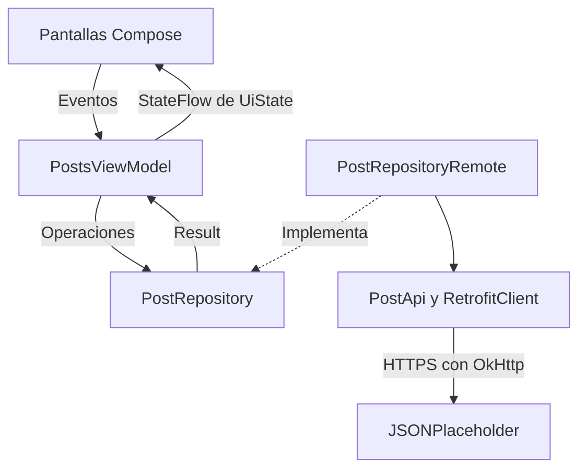
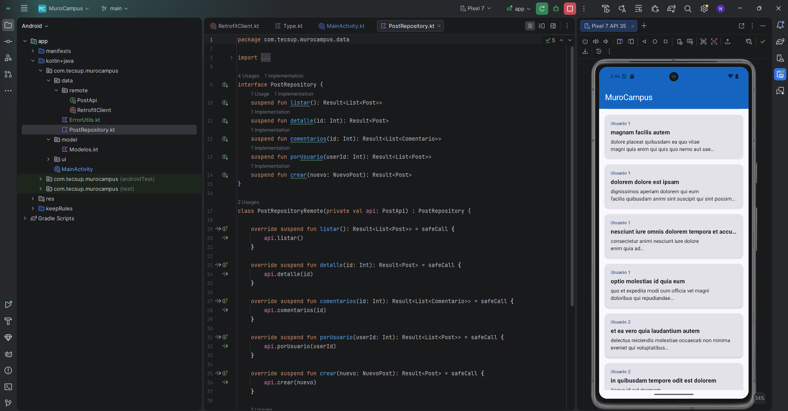
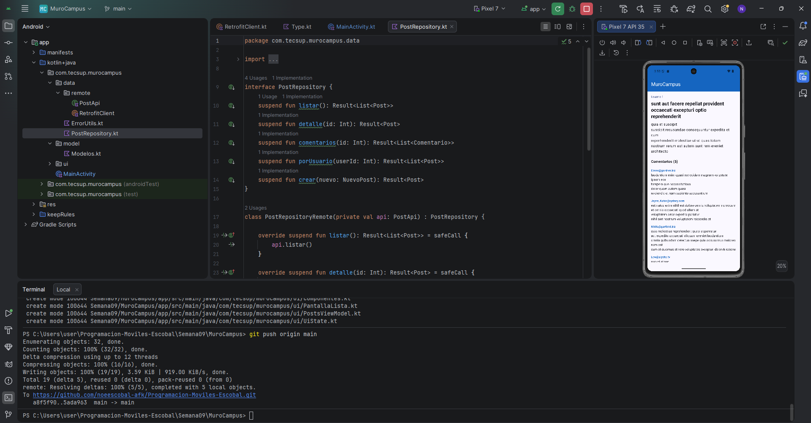
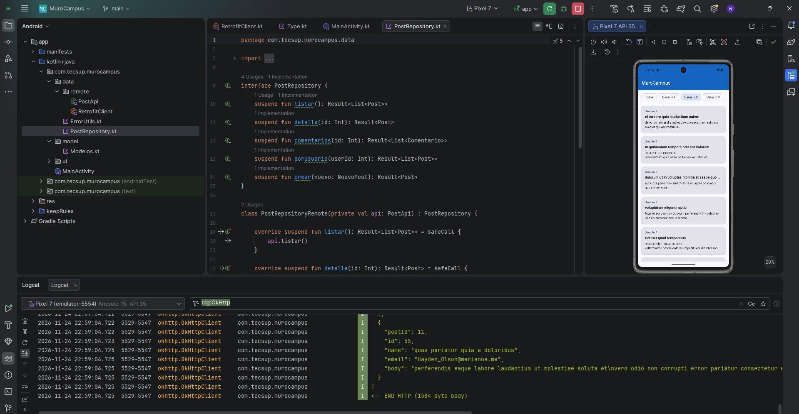
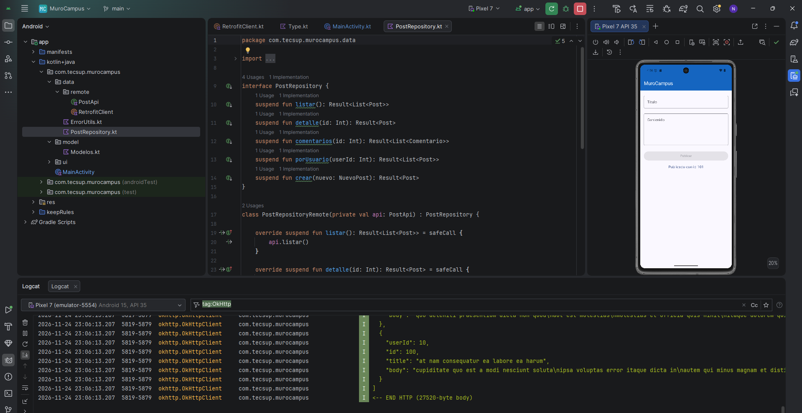
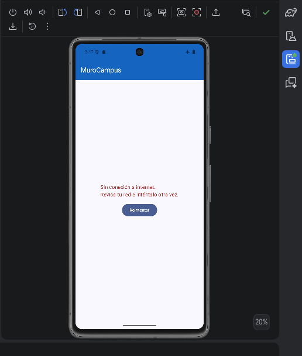

# MuroCampus

MuroCampus es una aplicación Android del Laboratorio 09 de Programación en Móviles. Con Kotlin y Jetpack Compose, consulta publicaciones de JSONPlaceholder, muestra los comentarios de un post, filtra por usuario y envía publicaciones de prueba. Ante un error de red, muestra un mensaje y permite reintentar.

## Estructura de paquetes

```text
app/src/main/java/com/tecsup/murocampus/
├── MainActivity.kt
├── data/
│   ├── ErrorUtils.kt
│   ├── PostRepository.kt
│   └── remote/
│       ├── PostApi.kt
│       └── RetrofitClient.kt
├── model/
│   └── Modelos.kt
└── ui/
    ├── Componentes.kt
    ├── PantallaCrear.kt
    ├── PantallaDetalle.kt
    ├── PantallaLista.kt
    ├── PostsViewModel.kt
    ├── UiState.kt
    └── theme/
        ├── Color.kt
        ├── Theme.kt
        └── Type.kt
```

## Arquitectura MVVM



Compose observa los estados de carga, éxito y error con `collectAsStateWithLifecycle()`. El ViewModel solicita datos a través de `PostRepository`. La implementación remota llama a `PostApi`, transforma los errores en `Result.failure` y relanza `CancellationException` para respetar la cancelación de corrutinas.

## Capturas de la aplicación

### Lista de publicaciones



### Detalle y comentarios



### Filtro por usuario



### Creación de una publicación



### Error de conexión



## Evidencias de verificación

Las pruebas se realizaron en un emulador Pixel 7 con Android 15 (API 35).

| Caso | Resultado observado | Evidencia |
|---|---|---|
| Carga desde el servicio | Logcat registró «Llegaron 100 publicaciones». | [Logcat](README-assets/logcat-100.png) |
| Rotación | La lista se veía en horizontal. | [Emulador rotado](README-assets/rotacion.png) |
| Recuperación de conexión | Tras el modo avión, la lista volvió a mostrarse. | [Modo avión](README-assets/modo-avion.png) · [Lista recuperada](README-assets/lista-recuperada.png) |
| Detalle sin conexión | El detalle mostró el error y se pudo volver a cargar. | [Error](README-assets/detalle-sin-conexion.png) · [Detalle recuperado](README-assets/detalle-recuperado.png) |
| Consulta por usuario | `GET /posts?userId=2` respondió HTTP 200. | [Logcat](README-assets/get-usuario-2.png) |
| Validación y envío | `Publicar` se deshabilitó con los campos vacíos. El envío de prueba respondió HTTP 201 y la app mostró el ID 101. | [Formulario vacío](README-assets/formulario-vacio.png) · [POST 201](README-assets/post-201.png) |
| Recurso inexistente | Al solicitar el post 9999, la app mostró «Error del servidor (404)». | [Error 404](README-assets/http-404.png) |
| Campo obligatorio faltante | Un campo requerido ausente en la respuesta produjo «Respuesta inesperada». | [Error de deserialización](README-assets/json-campo-faltante.png) |
| Campo extra en el JSON | Al excluir temporalmente `body` de la deserialización, la lista cargó con los títulos gracias a `ignoreUnknownKeys`. Al restaurar el modelo volvieron los textos. | [Campo extra](README-assets/json-campo-extra.png) · [Lista restaurada](README-assets/lista-restaurada.png) |

## Para pensar

1. **¿Qué diferencia hay entre GET y POST? ¿Por qué crear lleva `@Body` y porUsuario lleva `@Query`?** GET recupera datos y POST envía datos para crear un recurso en esta API. `@Body` serializa el objeto `NuevoPost` como JSON en el cuerpo de la petición. `@Query` agrega `userId` a la URL para filtrar la consulta.
2. **¿Por qué la ruta es `posts` y no `/posts`?** `posts` es relativa a la URL base y conserva su ruta. Una barra inicial resuelve la ruta desde la raíz del dominio. Con la URL base actual, ambas apuntarían al mismo endpoint porque la base ya está en la raíz.
3. **¿Por qué el Repository devuelve `Result`?** Para representar el éxito o el fallo de la operación de red con un contrato uniforme. El ViewModel convierte ese resultado en estado de pantalla y la cancelación se sigue propagando.
4. **¿Qué pasa si se olvida el permiso `INTERNET` o `ignoreUnknownKeys`?** Sin el permiso, la app no puede abrir la conexión. Sin `ignoreUnknownKeys`, un campo adicional que el modelo no declare puede provocar un error de deserialización. Un campo obligatorio ausente también produce un error, aunque `ignoreUnknownKeys` esté activo.
5. **¿Por qué usar `when` sobre `UiState`?** Cada valor representa un único estado de la pantalla. Con un tipo sellado, `when` permite cubrir todos los casos y evita las combinaciones contradictorias que podrían aparecer con tres variables independientes.
6. **¿Qué cambiaría con un servicio real?** Si el servidor persiste el POST, la app podría recargar la lista para mostrar la publicación nueva, o incorporar la respuesta del servidor al estado local y reconciliarla en la siguiente consulta. JSONPlaceholder simula la creación y devuelve un ID, pero no guarda el recurso.

## Material de referencia

- Guía GLAB-S09 de Programación en Móviles.
- Presentaciones previas del curso de Programación en Móviles.

## Historial de commits de MuroCampus

### Fase 1 · `main`

| Commit | Cambio |
|---|---|
| `d95ce66` | Importación del proyecto base. |
| `71fc894` | Permiso de Internet y dependencias de Retrofit. |
| `fb67e9d` | Modelos `Post`, `Comentario` y `NuevoPost`. |
| `0dbcea0` | Interfaz `PostApi` con GET y POST. |
| `f3c8eca` | Cliente Retrofit con OkHttp y conversor JSON. |
| `a8f5f90` | Repositorio con manejo de resultados mediante `Result`. |
| `5ada963` | Lista de publicaciones con estados de carga, éxito y error. |
| `5e41315` | Detalle de la publicación y comentarios con `@Path`. |
| `763541f` | Filtro por usuario con `@Query` y creación con `POST` y `@Body`. |
| `83f8abe` | Dependencias de ViewModel Compose e iconos. |
| `8cead5d` | README con estructura y capturas. |

[Ver historial de MuroCampus en main](https://github.com/noeescobal-afk/Programacion-Moviles-Escobal/commits/main/Semana09/MuroCampus/)

### Fase 2 · `mejora-ia-semana09`

| Commit | Cambio |
|---|---|
| `305d964` | Búsqueda local por título. |
| `a843e3e` | Encabezado `Accept: application/json` mediante OkHttp. |
| `0ccfba7` | Eliminación desde el detalle con `DELETE`. |
| `acd75e9` | Registro de prompts, decisiones y evidencias. |

[Ver historial de la Fase 2](https://github.com/noeescobal-afk/Programacion-Moviles-Escobal/commits/mejora-ia-semana09/Semana09/MuroCampus/)