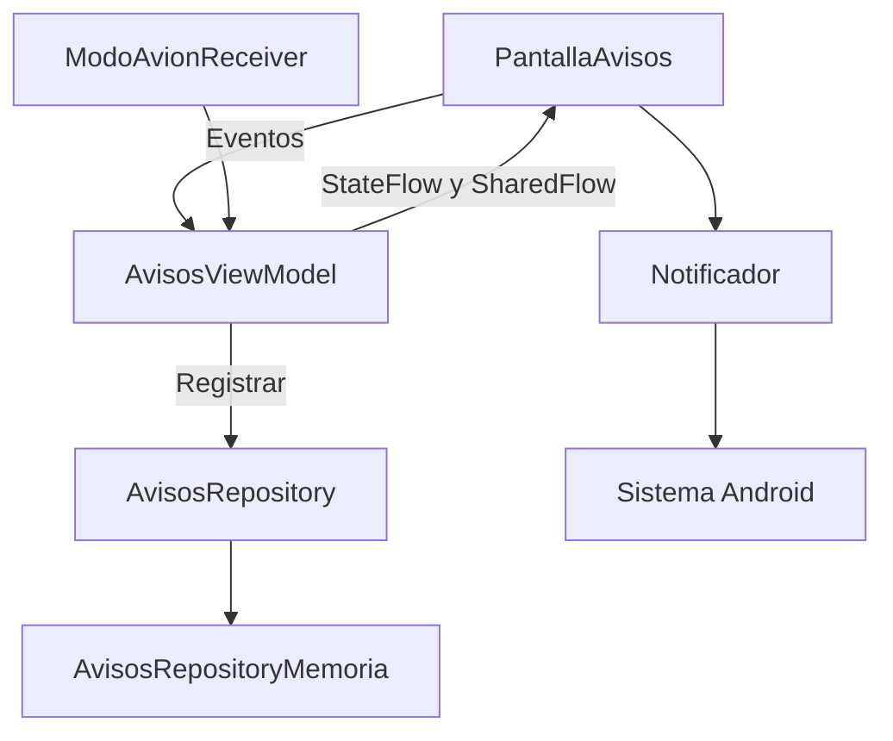
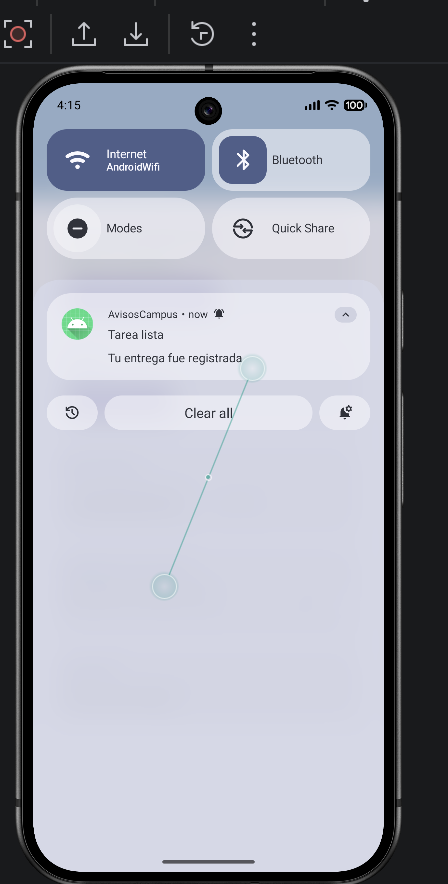
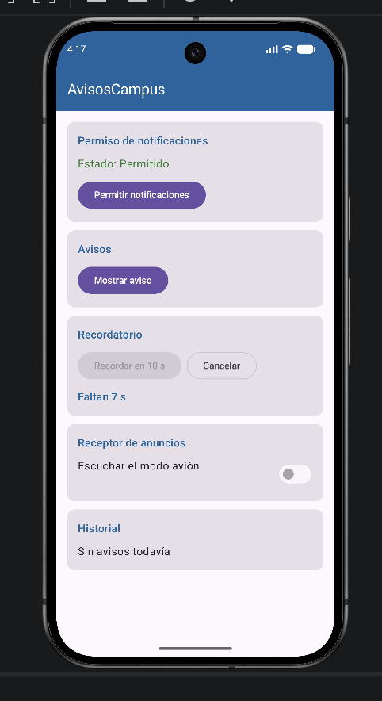
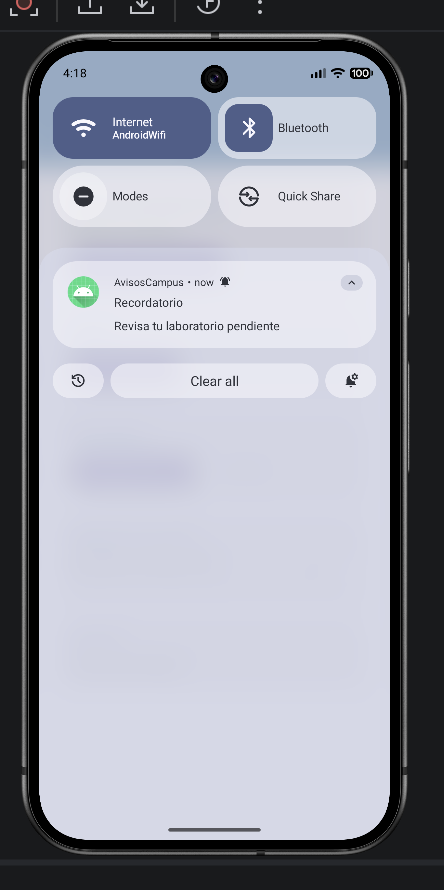
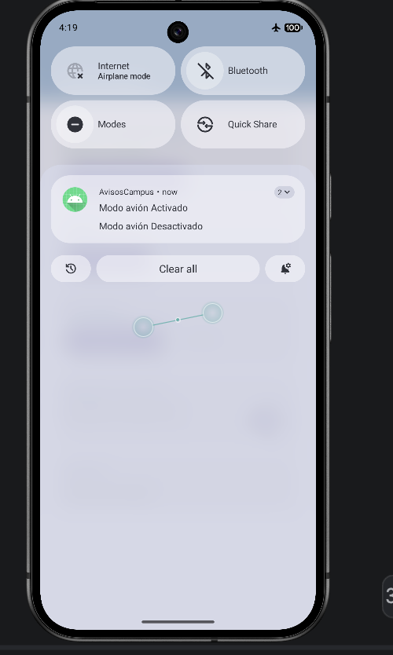
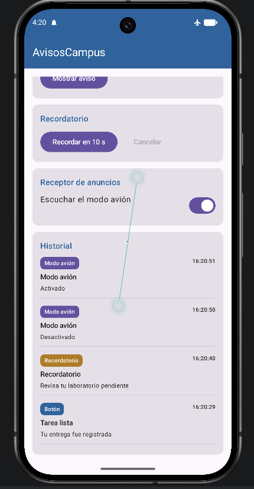
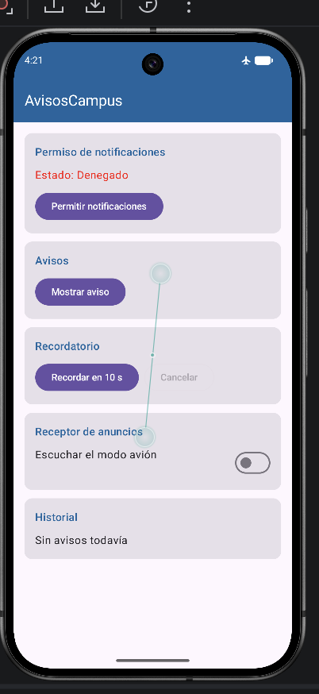
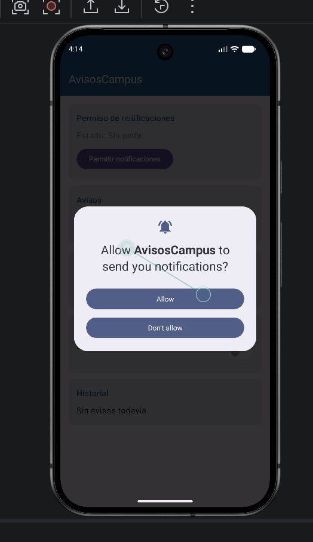
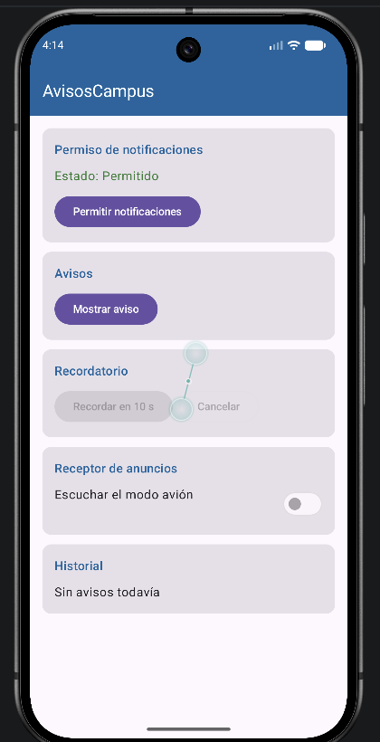

# AvisosCampus - Semana 15

## Descripción
Aplicación Android en Kotlin con Jetpack Compose y Material 3 que genera notificaciones locales, programa recordatorios de 10 segundos, escucha cambios del modo avión y registra avisos.

## Metodología
Se tomó como referencia el GLAB de Semana 15 y los conceptos de las guías anteriores, especialmente las corrutinas de Semana 14. Se utilizó ChatGPT como apoyo para reconstruir el proyecto base y desarrollar los pasos, conforme a la autorización del docente comunicada durante el laboratorio. El uso de Gemini de Android Studio se documentará en la rama mejora-ia cuando se realicen las mejoras.

## Estructura de paquetes
```text
com.tecsup.avisoscampus/
├── AvisosApp.kt
├── MainActivity.kt
├── model/Modelos.kt
├── data/AvisosRepository.kt
├── notificacion/Notificador.kt
├── receiver/ModoAvionReceiver.kt
├── viewmodel/
│   ├── AvisosViewModel.kt
│   └── AvisosViewModelFactory.kt
└── ui/
    ├── PantallaAvisos.kt
    ├── HistorialAvisos.kt
    └── theme/
```

## Arquitectura MVVM + Repository

El ViewModel decide qué avisar y registra el aviso en el Repository. La pantalla recibe el evento y llama al Notificador, que utiliza Context. El ViewModel no depende directamente de Context, NotificationManager ni BroadcastReceiver.

## Capturas reales
### 1. Notificación local
Se observa el aviso Tarea lista en el panel del sistema.



### 2. Recordatorio
Se observa la cuenta regresiva y el botón Cancelar habilitado.





### 3. Modo avión
Se observan avisos de activación y desactivación.



### 4. Historial
Se observan los avisos con origen, título, texto y hora, del más reciente al más antiguo.



### 5. Permiso denegado
Se observa el estado Denegado. Falta incorporar una captura del mensaje de advertencia y del aviso registrado sin permiso.



### Evidencias adicionales




## Pruebas de aceptación
- [x] Canal Avisos registrado (verificado por consola).
- [x] Solicitud de permiso y estados concedido y denegado.
- [x] Notificación Tarea lista.
- [ ] Dos notificaciones independientes del botón.
- [x] Apertura de la app al tocar la notificación (confirmada durante la prueba).
- [x] Cuenta regresiva y notificación de recordatorio.
- [ ] Recordatorio al minimizar la app.
- [ ] Cancelación sin notificación.
- [x] Modo avión activado y desactivado con escucha activa.
- [ ] Modo avión con escucha desactivada.
- [ ] Mensaje e historial al generar aviso con permiso denegado.
- [ ] Rotación durante el recordatorio.
- [x] Separación del ViewModel respecto de Android y unregisterReceiver en onDispose (según el código implementado).

## Para pensar
### 1. ¿Por qué una notificación necesita un canal y un permiso? ¿Qué pasa si falta cada uno?
El canal organiza las notificaciones y define su importancia desde Android 8. El permiso permite al usuario autorizar las notificaciones desde Android 13. Sin el canal obligatorio o el permiso requerido, no se muestra el aviso.

### 2. ¿Por qué el ViewModel emite un evento y no muestra la notificación él mismo?
Para separar la lógica del sistema Android. La pantalla recibe el evento y llama al Notificador con Context, lo que facilita las pruebas del ViewModel.

### 3. ¿Qué pasa si usas el mismo id en dos notificaciones?
La segunda actualiza o reemplaza la primera. Por eso se generan identificadores distintos.

### 4. ¿Por qué onReceive debe ser corto y por qué hay que quitar el receptor al salir?
Porque debe responder rápidamente sin bloquear el hilo principal. Se elimina el registro cuando deja de usarse para evitar fugas de memoria y escuchas innecesarias.

### 5. ¿En qué casos usarías una notificación local y en cuáles una push de Firebase?
Una local para recordatorios o eventos generados en el dispositivo; una push de Firebase Cloud Messaging para comunicados o eventos enviados desde un servidor remoto.

## Conclusión
Se implementaron notificaciones locales, recordatorios con corrutinas, escucha de anuncios del sistema e historial siguiendo MVVM + Repository. Las pruebas pendientes se deben completar antes de cerrar la fase.
